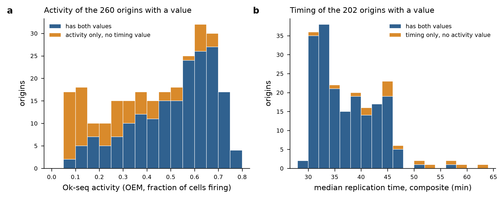

# Per-origin activity and replication time

Two values are attached to each *S. cerevisiae* origin in `public/data/origins.tsv` by
`bin/build_elements.py`, from call sets committed under `docs/`:

| column | what it is | units |
|---|---|---|
| `okseq_activity_oem` | **Ok-seq activity** — the efficiency (OEM) of the Okazaki-fragment initiation zone assigned to the origin: the fraction of cells in which the origin fires | 0 to 1 |
| `okseq_call` | the initiation zone the value came from | — |
| `okseq_distance_bp` | origin midpoint to that zone's derivative peak | bp |
| `median_replication_time_composite_min` | **median replication time, composite** — the Trep of the timing peak assigned to the origin | minutes after release from alpha-factor arrest |
| `replication_time_call` | the timing peak the value came from | — |
| `replication_time_distance_bp` | origin midpoint to the midpoint of that peak | bp |

The distance columns are published with the values so a user can see how well supported
each one is.

**The timing value is not a firing time.** Trep is the time by which half the cells have
replicated the DNA at that position. It is a composite of the firing-time distribution of
this origin and the passive-replication-time distribution produced by forks arriving from
neighbouring origins, and an early Trep can be produced either by early firing or by an
early neighbour. The column name says `composite` for that reason, and the release note
(`per_origin_values.columns` in `release.json`) repeats it; any page or export that shows
the value must carry the same qualification.

**An empty value is not a zero.** Both datasets measure firing. An origin with no
qualifying call was not *detected firing* in that experiment, which is a real and
interesting state — it may be licensed and rarely activated — and is not a measurement of
zero activity, nor of a replication time of zero. The build therefore writes an empty
field, never `0`, and the distinction is stated in `release.json` under
`per_origin_values.empty_is_not_zero`.

## The source datasets

| | Ok-seq activity | Replication time |
|---|---|---|
| calls | `docs/mcguffee2013_okseq_initiation_sites.bed` | `docs/muller2014_trep_peaks.bed` |
| n | 383 initiation zones | 212 timing peaks |
| study | McGuffee, Smith & Whitehouse 2013, PMID 23562327, GSE40696 | Muller *et al.* 2014, PMID 24089142, GSE42243 / GSE48212 |
| hub track | `sacCer3/mcguffee2013/okseq.initiation_sites.bb` | `sacCer3/muller2014/syncseq.trep.bw` |
| call definition | maxima of the derivative of fork directionality, OEM > 0.05 | local minima of the smoothed Trep profile; the interval is the band within 1 min of the trough |
| measured positional error (`docs/study_resolution.csv`) | median 348 bp, p75 1,160 bp | median 963 bp, p75 5,520 bp |
| caveat | raw OEM; the deconvolution correction of the original paper is not applied, so values near termination zones are under-estimates | the peak is called on 1 kb bins, so its position is quantised |

## The assignment rule

An origin takes the value of the nearest call **only** when both tests pass.

1. **Mutually nearest.** The call must be the origin's nearest call *and* that origin must
   be the call's nearest origin. This is the test that stops a value being attributed from
   a call that in fact belongs to a neighbouring origin, and it also guarantees that no
   call ever supplies two origins.
2. **Within a distance cap** set per assay from its measured positional error: **1,160 bp**
   for Ok-seq and **5,520 bp** for timing, each the 75th percentile of the displacement
   between a confirmed origin and that study's nearest call.

Distance is measured from the origin midpoint to the call's **anchor point**, and the
anchor is the same point against which that dataset's positional error was measured in
`docs/study_resolution.csv`: the derivative peak (BED `thickStart`) for an Ok-seq zone,
and the midpoint of the 1-minute band for a timing peak. Reproducing the published error
figures from these anchors is what fixes the convention — 348 / 1,160 bp and
963 / 5,520 bp come back exactly — so the cap and the distance it is applied to are the
same measurement.

### Why the p75, and not a round number

- The **median** error is the typical displacement of a true pairing; capping there would
  discard half of the genuine ones (it costs 83 origins of activity and 57 of timing, see
  the sensitivity table).
- The **p90 and beyond** are not positional spread at all. Both assays detect only a
  subset of origins (86% and 70% of confirmed origins have *any* call within 20 kb),
  so the far tail of the displacement distribution is made of origins the assay never
  detected, whose "nearest call" belongs to something else. `study_resolution.csv` says
  this explicitly for both rows and directs the p75 to be used as the positional error.
- The **p75** therefore sits where the distribution stops being about positional error and
  starts being about detection — and the counts confirm it: raising the cap beyond p75
  buys 12 more activity values (260 → 272 at twice the cap) and 1 more timing value
  (202 → 203).

Both caps are also small relative to the spacing of the origins they must not confuse: the
median distance between neighbouring origin midpoints is 16,671 bp, so a capped call
cannot reach past a neighbour except in the closest-packed few per cent of the genome
(25 origins have a neighbour within 2 x the Ok-seq cap, 138 within 2 x the timing cap) —
and those are exactly the cases the mutual-nearest test resolves.

## What the rule yields

Of the 410 *S. cerevisiae* origins (the 48 *S. pombe* origins have no cerevisiae
data and are left empty):

| | Ok-seq activity | Replication time |
|---|---:|---:|
| **assigned a value** | **260** (63%) | **202** (49%) |
| rejected by the cap alone (mutually nearest but too far) | 24 | 4 |
| rejected by the mutual test alone (close enough, but the call is nearer another origin) | 3 | 15 |
| rejected by both | 123 | 189 |
| no call on that sequence | 0 | 0 |

187 origins get both values, 73 activity only, 15 timing only, and 135 neither.

### Sensitivity to the cap

`mutual + cap` is the shipped rule; `cap only` drops the mutual test. The last column is
the number of origins that would be given a call that is nearer to a *different* origin —
the misattribution the rule exists to prevent.

| assay | cap (bp) | | mutual + cap | cap only | difference | calls serving two origins |
|---|---:|---|---:|---:|---:|---:|
| Ok-seq activity | 348 | median error | 177 | 177 | 0 | 0 |
| Ok-seq activity | 580 | half the cap | 234 | 234 | 0 | 0 |
| Ok-seq activity | 1,160 | p75 error = the cap | 260 | 263 | 3 | 3 |
| Ok-seq activity | 2,320 | 2x the cap | 272 | 279 | 7 | 7 |
| Ok-seq activity | 5,000 | 5 kb | 278 | 296 | 18 | 18 |
| Ok-seq activity | 9,977 | p90 error | 282 | 316 | 34 | 34 |
| Ok-seq activity | 20,000 | 20 kb | 284 | 351 | 67 | 65 |
| Replication time | 963 | median error | 145 | 145 | 0 | 0 |
| Replication time | 2,760 | half the cap | 197 | 205 | 8 | 8 |
| Replication time | 5,520 | p75 error = the cap | 202 | 217 | 15 | 15 |
| Replication time | 11,040 | 2x the cap | 203 | 239 | 36 | 36 |
| Replication time | 14,562 | p90 error | 205 | 261 | 56 | 56 |
| Replication time | 20,000 | 20 kb | 205 | 289 | 84 | 84 |

Two things to read off it. The count is **insensitive to the cap above the p75** — the
mutual-nearest test, not the cap, is what bounds it (284 and 205 origins even at 20 kb) —
so the cap is not doing the work of a tuning parameter. And the cost of dropping the
mutual test rises steeply with the cap: at 20 kb, 65 Ok-seq zones and 84 timing peaks
would each be claimed by two origins.

## The distributions

Assigned distances are well inside their caps: Ok-seq median 249 bp
(quartiles 114–427, max 1159), timing median
492 bp (quartiles 247–1037, max 5520).

| value | n | min | q1 | median | q3 | max |
|---|---:|---:|---:|---:|---:|---:|
| Ok-seq activity (OEM) | 260 | 0.050 | 0.285 | 0.494 | 0.629 | 0.781 |
| Median replication time, composite (min) | 202 | 29.5 | 32.5 | 36.2 | 42.2 | 62.8 |



*Both values, for the origins that have them, split by whether the origin also carries the
other value. Blue, origins with both; orange, origins with only the value on that axis.*

### Origins without a value are not inactive-but-measured; they are undetected

The two assays miss different origins, and the misses are informative rather than random.

- Origins that get **no activity value** replicate markedly **later** than those that do:
  median Trep 45.2 min (n=15) against
  35.6 min (n=187); Mann-Whitney p = 2.6e-05.
- Origins that get **no timing value** are markedly **less efficient** than those that do:
  median OEM 0.260 (n=73) against 0.561
  (n=187); Mann-Whitney p = 2.4e-14.

Both comparisons point the same way: the origins that drop out are the late, inefficient
ones, which fire in too few cells to raise a detectable initiation zone or a local minimum
in the timing profile. That is precisely why an absent value must not be published as a
zero — a zero asserts a measurement of no firing, whereas the empty field records that
this origin's firing, if any, was below what the experiment could resolve. A user filtering
on activity should therefore treat the 150 origins without a value as *unmeasured*, not as
the bottom of the activity range.

## Reproducing

The values are produced by step 3 of the pipeline, not by hand:

```bash
python3 bin/build_elements.py /path/to/nieduszy_oridb.sql --sacCer3 DIR
```

The rule, the caps, the datasets and the counts above are written into
`public/data/release.json` under `per_origin_values`, and the md5 of the regenerated
`origins.tsv` is updated in `files`.
