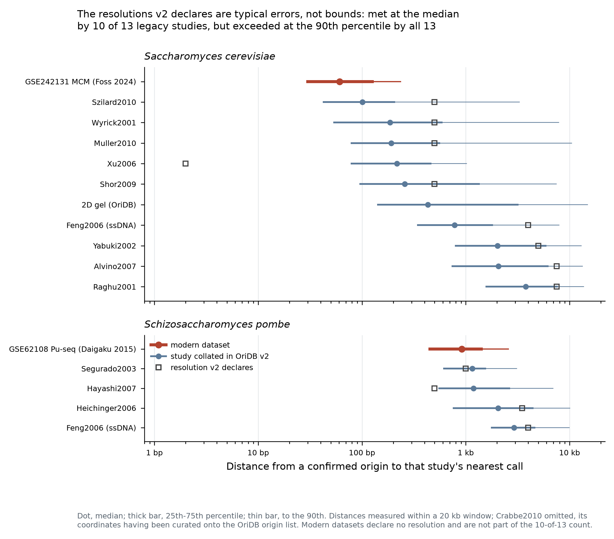

# Rebuilding the origin tiers from modern data

A proposal for discussion, not a decision. Written 2026-11-18.

The Confirmed tier is a direct-evidence tier: every one of its 458 origins overlaps a
plasmid (ARS) assay or a 2D gel record, and that is a claim about an experiment someone
did at that locus. The remaining v2 tiers are not like that — they were assembled from
the mapping data of the mid-2000s. Rebuilding them means choosing modern datasets and
defining how they combine, so this note covers both, and replaces v2's three tiers with
four: **confirmed**, **likely**, **unsupported** and **refuted**.

## What each data type would come from

Candidates below were found by searching GEO and resolving every linked publication; the
accessions and citations are as the archives report them.

### S. cerevisiae — initiation site mapping (Ok-seq family)

| dataset | source | assay | why |
|---|---|---|---|
| GSE40696 | McGuffee et al. 2013, Molecular cell, PMID 23562327 | Okazaki fragment sequencing | Quantitative initiation *and* termination genome-wide; the standard reference for origin efficiency in budding yeast. First choice. |
| GSE33786 | Smith et al. 2012, Nature, PMID 22419157 | Okazaki fragment sequencing | The original OF-seq. Small (4 samples); useful as an independent corroboration rather than a primary. |
| GSE134219, GSE145032 and related | GLOE-Seq series | nucleotide-resolution strand-break mapping | An orthogonal route to the same signal; worth holding as a cross-check. |
| GSE125855 | HydEn-seq | ribonucleotide incorporation | Polymerase usage in cerevisiae, the direct analogue of the pombe method below. |

### S. pombe — initiation site mapping

Fission yeast has no Ok-seq in GEO; its analogue is polymerase usage sequencing.

| dataset | source | assay | why |
|---|---|---|---|
| GSE62108 | Daigaku et al. 2015, Nature structural & molecular biology, PMID 25664722 | Pu-seq | The canonical genome-wide initiation map for pombe. First choice. |

### S. cerevisiae — protein footprint

| dataset | source | assay | why |
|---|---|---|---|
| GSE242131 | Foss et al. 2024, eLife, PMID 38315095 | MCM/ORC footprint | Publishes a modern genome-wide origin call set, not just signal. Both a footprint source and a ready-made comparison for our own calls. First choice. |
| GSE240779 | Reuter et al. 2024, Nature communications, PMID 39181881 | ORC and MCM2-7 | Licensing-focused, recent, 44 samples. |
| GSE249817 | Chappleboim et al. 2024, Nucleic acids research, PMID 38597680 | ORC binding | 258 samples; the deepest ORC dataset found. |
| GSE173529, GSE240472 | MCM2-7 loading at near base-pair resolution | ChIP-exo | Highest positional resolution; the natural partner for the ACS element layer. |
| GSE16926 | Eaton et al. 2010, Genes & development, PMID 20351051 | ORC ChIP plus nucleosome positioning | Already the source of OriDB's Eaton2010 elements. Worth keeping as the continuity anchor between v2 and v3. |

### S. pombe — protein footprint

| dataset | source | assay | why |
|---|---|---|---|
| GSE125335 | Masuda et al. 2020, Open biology, PMID 32692956 | Orc4 and Mcm2 ChIP-seq | Describes fission yeast origins in terms of AT content and pre-RC binding — the pombe equivalent of the ACS layer. First choice. |
| GSE6523 | Hayashi et al. 2007, The EMBO journal, PMID 17304213 | ORC and MCM localisation | The historical pre-RC map; continuity with what v2 drew on. |
| GSE150800 | Foss et al. 2021, PLoS genetics, PMID 34473702 | Mcm2-7 distribution | Covers cerevisiae and pombe in one study, so it calibrates the two species against each other. |

## How the intersection could work

The important change is structural: **tier should be a derived value, not a stored
opinion.** Today `status` is a column copied from v2. If it is to reflect several
datasets, it needs to be computed from them by a rule that is written down and rerun
whenever a dataset is added — otherwise the tiers drift out of agreement with the
evidence behind them, which is the failure mode v2 eventually hit.

That implies a new table between origins and datasets:

    evidence_matrix.tsv : origin accession x dataset -> score, call, assembly, threshold

with `origins.tsv` carrying only the tier that the rule produces from it. Every dataset
is lifted to sacCer3 or ASM294v2 before scoring, exactly as the existing layers are.

### Proposed axes

1. **Initiation** — Ok-seq or Pu-seq signal at the site.
2. **Licensing** — an ORC or MCM footprint at the site.
3. **Timing** — from the replication timing work in progress.
4. **Direct assay** — plasmid ARS or 2D gel; what the Confirmed tier already uses.
5. **Negative evidence** — ARS assays showing a fragment does *not* function. OriDB v2
   holds 225 such records in `sc_cloned_no_ori`, which v3 does not yet publish.

### The four categories

v2's three tiers become four. The change is not cosmetic: v2's Dubious conflated a site
nobody has corroborated with a site that was tested and failed, which are opposite claims
about the evidence. Splitting them makes each category a statement that can be checked
against the matrix.

| category | definition | what it asserts |
|---|---|---|
| **confirmed** | an ARS assay or a 2D gel shows origin function at the site | an experiment demonstrated the origin |
| **likely** | two or more modern datasets identify the site | independent modern methods agree, but it has not been directly assayed |
| **unsupported** | identified by one modern study, or by any number of legacy studies | the site is on record, but nothing current corroborates it |
| **refuted** | an ARS assay shows no origin at the site | an experiment tested the site and found no origin |

Three properties follow, and are the reason for preferring this to v2's scheme.

- **Nothing disappears.** A v2 origin with no modern site is not deleted and not demoted
  to an ambiguous label: it becomes *unsupported*, keeping its accession, its citations
  and its page. The category says what is true of the evidence, not what is true of the
  origin.
- **Legacy evidence does not accumulate into support.** Any number of legacy studies
  still gives *unsupported*, because the measured resolutions above show those studies
  agree with each other at kilobase scale — several of them calling the same approximate
  region is weak corroboration, not strong.
- **Refuted is not the bottom of a scale.** It is a separate, positive finding, and
  OriDB v2 already holds 225 of them in `sc_cloned_no_ori`, which v3 does not yet
  publish. A refuted site can also be confirmed elsewhere nearby, so the two are
  properties of a site, not points on one axis.

Two details still need settling when the rule is implemented: whether *likely* requires
its two datasets to be of different kinds (an initiation dataset and a footprint dataset,
rather than two footprint datasets), and what happens to a site that is both confirmed
and refuted by different assays — which the ARS assay literature does contain.

### Feasibility check against what GEO actually publishes

Decisions taken: the site list will be the union of modern calls with v2 identity carried
across, and datasets enter through their authors' published calls, with selective
re-analysis later. Checking what the four primaries actually ship changes the picture for
two of them.

| dataset | what GEO carries | usable as a call set? |
|---|---|---|
| GSE242131 | `GSE242131_17618_CMBSs_chr_coord_rank_082923_1.txt.gz` | Yes. 17,618 MCM binding sites, single-base coordinates on sacCer3 chromosome names, with abundance and rank. |
| GSE62108 | `GSE62108_origin-effici.bedgraph.gz` | Yes. 1,145 origins across the three pombe chromosomes with an efficiency percentage each; also ships timing and fork-direction tracks. |
| GSE40696 | raw archive plus per-sample `.sgr` signal | No. Calls are not in GEO; they are in the paper's supplementary, or must be derived from the signal. |
| GSE125335 | raw archive plus per-sample Orc4 `.wig` and a smoothed `.bedgraph` | No. Signal only, same position. |

So "published calls" is available for half the axes. For the other half the cheap route is
not raw re-analysis but calling from the processed signal the authors published, which is
a much smaller undertaking than reprocessing reads and keeps the provenance clear.

Both available call sets agree with the Confirmed tier, which is the first real evidence
that this approach will hold together:

- 357 of 410 cerevisiae Confirmed origins (87%) contain at least one MCM binding site;
  344 (84%) contain one ranked in the top 1,600.
- 41 of 48 pombe Confirmed origins (85%) overlap a Pu-seq origin, at a median efficiency
  of 59% (range 4-80%).

These are independent evidence types agreeing at sites defined by a third, so the
coordinate frames line up and the axes are measuring what we think they measure. The
13-15% of Confirmed origins with no modern support are worth a look on their own terms:
they stay Confirmed, because direct assay evidence is what that tier means, but a
confirmed origin that licenses no MCM is an interesting record rather than a dull one.

## How OriDB did this before

The rule is in the 2007 paper (Nieduszynski *et al.*, *Nucleic Acids Research*, PMID
17065467); the 2012 update defers to it rather than restating it. Four things are worth
carrying forward.

1. **Resolution was measured, not declared.** Each microarray study's proposed origin
   locations were compared with confirmed origin sites, and an error was derived from
   that comparison.
2. **Studies were ranked best-resolution-first.** The 2007 table gives: ARS-assayed
   fragment +/-0; 2D gel restriction fragment +/-0; proARS from ChIP +/-500 bp;
   copy-number timing peak +/-3,500; ssDNA/HU peak +/-4,000; heavy:light timing peak
   +/-7,500.
3. **Two calls are one origin if they overlap once each study's error is added**, so the
   merge threshold is the *sum* of the two errors. Their worked example: Raghuraman
   (7.5 kb) and Yabuki (3.5 kb) are the same origin below 11 kb apart and distinct above.
4. **Amalgamation was greedy down the ranking.** The cloned origins went in first, then
   each successive list contributed only the sites not already present, with the
   lower-resolution lists labelled as having identified them.

Status then followed from how many studies supported a site: Confirmed for ARS or 2D gel,
Likely for two or more microarray studies, Dubious for one. Manual overrides were allowed
and marked with an asterisk. The scheme proposed here is the same logic with modern
datasets in place of microarray studies, plus *refuted* as a distinct outcome.

The per-study error values survive in the v2 database: `sc_ori_studies` and
`sp_ori_studies` each carry a `resolution` column, for 12 and 6 studies respectively,
ranging from 0 to 7,500 bp.

## What the resolutions actually are

Since the merge rule is driven entirely by these numbers, they were re-measured the way
2007 describes: for every confirmed origin, the distance to that study's nearest call,
within a 20 kb window. Call width — the width of the feature a study reports — is
recorded separately, because the two are not the same thing. Several studies report a
single-base peak position with a multi-kilobase error, while a 2D gel reports a 4.7 kb
restriction fragment that localises an origin to within a few hundred bases. Width is
what a study draws; error is what it knows.

*Distance from each confirmed origin to the nearest call of each study, on a log scale.
Dot, median; thick bar, 25th to 75th percentile; thin bar, out to the 90th. Open squares
mark the resolution OriDB v2 declares for that study. Red marks the two modern datasets,
which declare no resolution. Crabbe2010 is omitted — see the caveat below. The same
numbers are in `study_resolution.csv`.*

*The figure predates the timing row below and does not show it: it is drawn from
per-study percentile arrays that `study_resolution.csv` does not carry, so it cannot be
redrawn from the table. `study_resolution.csv` is the current record; the figure covers
every row above it.*

### Measured resolution, *S. cerevisiae*

| study | calls | call width (median) | resolution v2 declares | measured error: median | p75 | p90 | confirmed origins detected |
|---|---:|---:|---:|---:|---:|---:|---:|
| sc_cloned_ori * | 421 | 294 | 0 | 0 | 0 | 0 | 100% |
| Wyrick2001_ori | 416 | 619 | 500 | 186 | 599 | 8144 | 90% |
| Xu2006_ori * | 529 | 1911 | 2 | 217 | 467 | 1049 | 99% |
| Alvino2007_ori | 275 | 1 | 7500 | 2057 | 6306 | 13359 | 87% |
| Raghu2001_ori | 332 | 1 | 7500 | 3785 | 7738 | 13792 | 90% |
| sc_2D_gel * | 49 | 4669 | 0 | 432 | 3214 | 15194 | 11% |
| Yabuki2002_ori | 276 | 1 | 5000 | 2020 | 5983 | 12978 | 84% |
| Crabbe2010_ori * | 494 | 501 | 500 | 0 | 64 | 1235 | 94% |
| Feng2006_ori | 353 | 1 | 4000 | 782 | 1825 | 7958 | 96% |
| Szilard2010_ori | 434 | 11 | 500 | 101 | 209 | 3298 | 96% |
| Shor2009_ori | 541 | 1301 | 500 | 258 | 1425 | 7553 | 92% |
| Muller2010_ori | 398 | 1276 | 500 | 191 | 584 | 10466 | 90% |
| GSE242131_MCM_all | 17618 | 1 | n/a | 61 | 130 | 237 | 100% |
| GSE242131_MCM_top1600 | 1600 | 1 | n/a | 61 | 144 | 322 | 99% |
| Muller2014_Trep_peaks | 212 | 6000 | n/a | 963 | 5520 | 14562 | 70% |

### Measured resolution, *S. pombe*

| study | calls | call width (median) | resolution v2 declares | measured error: median | p75 | p90 | confirmed origins detected |
|---|---:|---:|---:|---:|---:|---:|---:|
| Feng2006_sp_ori | 366 | 1 | 4000 | 2912 | 4705 | 10700 | 92% |
| sp_2D_gel * | 48 | 3976 | 1 | 0 | 0 | 0 | 100% |
| Heichinger2006_ori | 401 | 1 | 3500 | 2043 | 5011 | 10187 | 92% |
| Hayashi2007_ori | 459 | 1 | 500 | 1185 | 2721 | 7324 | 90% |
| Segurado2003_ori | 387 | 1 | 1000 | 1156 | 1671 | 3691 | 100% |
| GSE62108_Pu-seq | 1145 | 301 | n/a | 917 | 1555 | 2735 | 100% |

\* carries a note in `study_resolution.csv`.

Three findings bear on the rule:

- **The declared resolutions are typical errors, not bounds.** The measured median is
  within the declared value for 10 of 13 legacy studies, but the 90th percentile exceeds
  it for all 13. Since the 2007 rule uses these values as bounds on how far apart two
  calls can be and still be one origin, using the declared figures under-merges in the
  tail. The measured p90 is the number to put into the rule.
- **Three studies miss even at the median**: Xu2006 (217 bp against a declared 2 bp),
  Hayashi2007 (1,185 against 500) and Segurado2003 (1,156 against 1,000).
- **Modern data is an order of magnitude better than anything in v2.** The MCM footprint
  set has a median error of 61 bp and a p90 of 237 bp while detecting 100% of confirmed
  origins; Pu-seq is at 917 bp median and 2.7 kb p90, also at 100%. Merge distances built
  from these will be hundreds of bases, not kilobases.

### A caveat that applies to any study we add

Some v2 study tables are not independent of the origin list they would be measured
against. Crabbe2010 has 62% of its intervals *identical* to an `sc_ori` interval and 73%
sharing a midpoint: its coordinates were curated onto the OriDB list rather than reported
independently, and it duly measures a median error of 0 bp — better than any real dataset,
which is how the problem surfaced. `sc_cloned_ori` (97% identical) and `sp_2D_gel` are 0
by construction, since they define the Confirmed tier.

Before any study's error is trusted, its intervals should be checked for identity against
the origin list. A study that was curated onto the list cannot be used to measure its own
resolution.

### The timing axis, measured

Timing is the third proposed axis, and unlike the others it has no published call set to
borrow: the replication timing data in this project is the lab's own sort-seq / sync-seq
pipeline reimplemented on sacCer3, served as bigWig in the
[OriDB data hub](https://dnareplicationlab.github.io/oridb-data-hub/hub.txt). Calls were
therefore made from the signal, which is decision 2 below taken for this one axis.

The call set is the local minima of the sync-seq **Trep** track — median replication time
in minutes from alpha-factor release, 1 kb bins. That an origin is a *minimum* was checked
rather than assumed: the 350 confirmed cerevisiae origins falling in a fitted bin sit at a
median Trep of 38.2 min against a genome-wide median of 43.3 min, the 25th percentile of
the genome-wide distribution (Mann-Whitney p = 1.1e-36). Calling maxima instead would have
put every call in a termination zone. The profile was smoothed with a 2 kb Gaussian and
peaks taken at a prominence of at least 2 minutes — about four times the noise of the
smoothed track — giving **212 calls**, median width 6 kb (the band within 1 minute of the
trough minimum). Method and parameters:
[`docs/trep_peak_calls.md`](https://github.com/DNAReplicationLab/oridb-data-hub/blob/main/docs/trep_peak_calls.md)
in the hub repository; the calls are
[`docs/muller2014_trep_peaks.bed`](muller2014_trep_peaks.bed) here and a bigBed track in
the hub.

Measured the same way as every row above — confirmed origin to nearest call, 20 kb window
— the timing axis comes out at **median 963 bp, p75 5,520, p90 14,562, p95 17,092, with
70% of confirmed origins detected**. Two features of that distribution matter more than
the headline:

- **It is bimodal, not wide.** 150 of the 410 confirmed origins lie within 1 kb of a
  timing call and 204 within 2.5 kb; the p75 and p90 are not a tail on those, they are a
  different population — confirmed origins that fire late or inefficiently and make no
  trough of their own, whose nearest call is the neighbouring origin tens of kilobases
  away. A timing peak locates an origin well or not at all.
- **The median is a property of the data, not of the parameters.** Across smoothing from
  0 to 3 kb and prominence from 1 to 4 minutes the number of calls moves from 1,157 to
  144 and detection from 98% to 50%, while the median error stays between 0.8 and 1.7 kb.
  Parameters buy sensitivity; they do not buy resolution.

The circularity check the caveat above demands: none of the 212 calls shares an interval
with an origin record and one shares a midpoint, against 62% identical intervals for
Crabbe2010. They are derived from sequencing signal by a procedure that never saw the
origin list, and the coordinates are bin-quantised, so identity is not a strong test here;
the substantive evidence is the other direction — 207 of the 212 calls fall within 20 kb
of a confirmed origin, at a median of 526 bp. The calls land on origins without being
copies of them.

**What this implies for the rule.** Under the 2007 sum-of-errors rule the merge distance
contributed by an axis is its error, so a timing call merged with an MCM footprint call
(p90 237 bp) at the measured p90 gives 14,562 + 237 ≈ **14.8 kb**, and two timing calls
29.1 kb. The median spacing between adjacent confirmed origins is 26.9 kb, so a 14.8 kb
window would routinely swallow a neighbour: timing cannot be a site-*defining* axis. It
should be a corroborating one — asked whether a timing call exists near a site that a
footprint or initiation dataset has already defined — and at the tolerance where it
actually performs, the median to p75 band of roughly 1-5 kb rather than the p90. On the
scale of the other axes this is the coarsest evidence we have: MCM footprint 61 bp median,
Pu-seq 917 bp, timing 963 bp at the median but two orders of magnitude worse in the tail.

Its value is not positional. 70% detection at a 20 kb window is the lowest coverage of any
cerevisiae dataset measured here, and that is informative in itself: it says which
confirmed origins are efficient enough to shape the replication profile, which is a
property no footprint dataset reports.

## What has to be decided before any of this is built

1. **What a site is.** These assays call features of very different widths — an Ok-seq
   initiation zone can be kilobases, an MCM footprint is around a hundred bases. The
   intersection needs a defined merge distance and a canonical site definition before any
   rule can be applied.
2. **Where the two signal-only axes get their calls.** Journal supplementary tables, or
   calling from the published signal tracks. The second is more work but makes those axes
   commensurable with each other, which the published tables will not be.
3. **Which initiation study and which footprint study to use.** Parked; the measured p90
   column is the figure to compare candidates on, and two of the shortlist cannot be
   measured at all until decision 2 is taken.

Settled: the disposition of v2 origins with no modern site. Under the four categories
they become *unsupported*, keeping their accessions and pages, so nothing is deleted and
no retired state is needed.

Sources used for the feasibility check:
`ftp.ncbi.nlm.nih.gov/geo/series/GSE242nnn/GSE242131/suppl/` and
`ftp.ncbi.nlm.nih.gov/geo/series/GSE62nnn/GSE62108/suppl/`.
