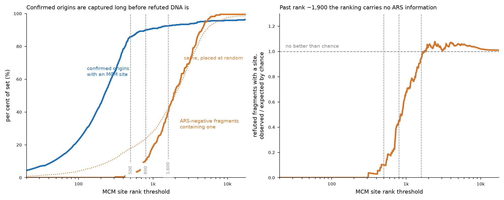

# Rebuilding the origin tiers

How every site in OriDB v3 is placed in a tier, which datasets decide it, where each
threshold came from, and what changing one would cost. Produced by `bin/build_tiers.py`;
the numbers below are read back from `public/data/release.json` after a build.

The 2012 tiers were a judgement about the literature of the time. This rebuild replaces
them with a rule evaluated against genome-wide datasets re-analysed on the current
assemblies. Nothing from v2 is discarded: every origin it held is still here, with its
accession, its identifiers and its evidence records.

## The tiers

| tier | rule |
|---|---|
| **Confirmed** | a positive plasmid (ARS) assay or a 2D gel at this site |
| **Likely** | no such assay, but at least two modern datasets support the site and at least one of them measures **licensing** |
| **Unsupported** | datasets cover this species and fewer than that support the site |
| **Not assessed** | no dataset in the registry covers this species yet |

Counts after the current build:

| species | Confirmed | Likely | Unsupported | Not assessed |
|---|---:|---:|---:|---:|
| *S. cerevisiae* | 413 | 40 | 386 | — |
| *S. pombe* | 48 | — | — | 693 |

and how the 2012 tiers moved:

| OriDB 2012 | → Confirmed | → Likely | → Unsupported |
|---|---:|---:|---:|
| Confirmed (410) | 410 | — | — |
| Likely (216) | 1 | 26 | 189 |
| Dubious (203) | 2 | 9 | 192 |
| new in v3 (10) | — | 5 | 5 |

The three promotions to Confirmed are v2 records that already overlapped a positive ARS
assay or a 2D gel but were not Confirmed in v2 (`sc_ori` 79, 84 and 741). They are raised
as a known issue for curator review rather than quietly reclassified.

### Why *likely* requires a licensing dataset

Assays divide into two kinds, and the division matters more than the count.

- **Firing** assays — Okazaki-fragment sequencing, replication timing, Pu-seq — detect an
  origin only when it actually initiates in enough cells to leave a signal.
- **Licensing** assays — MCM and ORC footprinting — detect the helicase loaded at an
  origin, whether or not it ever fires.

Firing assays share a blind spot: an origin that is licensed but rarely activated is
invisible to all of them at once. Two firing datasets agreeing is therefore weaker
evidence than one firing and one licensing dataset agreeing, because the two firing
assays can fail together for the same biological reason.

Requiring one of each would be worse. It would make *likely* mean *active*, and write
licensed-but-dormant origins out of the tier by definition — exactly the class the firing
blind spot already hides. So the rule constrains the kind without demanding activity: at
least one licensing dataset, plus any second independent dataset.

A stricter version — two independent *footprinting* methods agreeing — is better still
and is not yet possible; see "What is missing" below.

## The dataset registry

`reference/datasets.tsv` is the single place a dataset is declared. Adding one is a row
plus its call file, then a rerun.

| dataset | study | measures | counts | window | threshold |
|---|---|---|---|---:|---|
| `foss2024_mcm` | Foss *et al.* 2024, PMID 38315095 | licensing | yes | 500 bp | rank ≤ 500 |
| `mcguffee2013_okseq` | McGuffee, Smith & Whitehouse 2013, PMID 23562327 | firing | yes | 1,160 bp | — |
| `reuter2024_mcm` | Reuter *et al.* 2024, PMID 39181881 | licensing | yes | 500 bp | MCM2-7 double-hexamer calls |
| `reuter2024_orc_nonorigin` | Reuter *et al.* 2024, PMID 39181881 | ORC without MCM2-7 | **no** | 500 bp | — |
| `muller2014_trep` | Müller *et al.* 2014, PMID 24089142 | timing | **no** | 5,520 bp | — |

Each dataset supports a site when one of its calls lies within the window of the site
interval. The windows do not all come from the same place, and it matters which:

- `mcguffee2013_okseq` (1,160 bp) and `muller2014_trep` (5,520 bp) are the **measured p75
  positional error** of that assay against the confirmed origins, from
  `docs/study_resolution.csv`.
- `foss2024_mcm` (500 bp) is **not** its measured p75, which is 130 bp. That figure was
  measured against curated confirmed-origin intervals; the sites being tested here include
  v2 records whose coordinates are a good deal less precise — 15 confirmed origins have no
  MCM site within ±250 bp but 14 of them have one within 1,486 bp — so the window is a
  deliberate tolerance rather than a measurement.
- `reuter2024_orc` (500 bp) has **no measured positional error at all**; the published
  table is already thresholded and carries no score. 500 bp is provisional, matched to the
  other footprint dataset.

The two licensing windows are the ones that gate the *Likely* tier, so the choice is worth
seeing rather than assuming. Narrowing the Foss window to its measured p75 would cost nine
sites and create no others:

| Foss window | Likely | Unsupported | novel sites |
|---|---:|---:|---:|
| 130 bp (its measured p75) | 49 | 377 | 10 |
| 250 bp | 52 | 374 | 10 |
| **500 bp (shipped)** | **58** | **368** | **10** |

Sites supported, per dataset: `foss2024_mcm` 456, `mcguffee2013_okseq` 327,
`reuter2024_mcm` 322.

**Replication timing is recorded but excluded from the tier.** A timing peak locates where
replication happened, not where it initiated, and the p90 of its displacement measures
whether an origin was detected rather than how precisely it was placed. It stays in the
matrix so that the exclusion is visible and auditable rather than silent.

**Licensing means MCM2-7 loading, so only Reuter's MCM table counts.** Reuter reports
MCM2-7 double hexamers, ORC footprints at origins, and 242 ORC footprints at sites the
paper annotates as **non-origin** — ORC bound, no MCM2-7 loaded. An earlier version of this
build used that last set as the licensing axis, on the reasoning that it was the only part
of Reuter's data not drawn from the OriDB origin list. That was wrong twice over: ORC
binding is not licensing, and a site the authors annotate as a non-origin cannot be
evidence that an origin is there. It supported 35 Likely and 30 Unsupported sites before it
was withdrawn. It stays registered with `counts_towards_tier = no`, so the matrix records
that those sites were examined and carry ORC without MCM2-7.

The MCM table that replaces it is honest but weak: it is indexed on the OriDB origin list,
with 295 of its 308 calls at a Confirmed origin, so it can seldom promote anything by
itself. It is kept because where it does fall on a non-Confirmed site, that is real
evidence.

## Where the Foss rank cut came from

Foss ranks 17,618 MCM sites. Taking all of them would make the dataset meaningless; the
question is where the ranking stops carrying information about ARS function. The
`sc_cloned_no_ori` fragments answer it: 224 pieces of DNA that were cloned and did **not**
support autonomous replication. A top-ranked MCM site inside one of those is a
contradiction.

| rank depth | confirmed origins captured | ARS-negative fragments contradicted | expected by chance |
|---:|---:|---:|---:|
| 200 | 45.4% | 0.0% | 7.8% |
| **500** | **85.9%** | **1.8%** | 17.8% |
| 800 | 90.0% | 10.7% | 23.8% |
| 1,600 | 92.4% | 40.2% | 42.2% |
| 2,000 | 92.9% | 53.1% | 50.8% |
| 17,618 | 96.3% | 99.6% | 98.6% |

Chance expectation matters because the negative fragments are wide — median 4,685 bp
against 286 bp for a confirmed origin interval — so they catch sites by luck; the column
is 200 shuffles of the same fragments placed at random on the same chromosome.

Three things fall out.

1. **Past rank ~1,900 the ranking is uninformative.** Observed contradictions reach the
   chance rate there: a Foss site that deep is no more likely to fall in ARS-negative DNA
   than a randomly placed interval. The paper's headline cut of 1,600 sits just inside the
   last informative stretch.
2. **The exchange rate rises steeply.** Up to 500, each extra band of rank costs 0.01
   contradicted fragments per origin captured; 500→800 costs 1.2, 800→1,600 costs about 6,
   and 1,600→2,000 costs 14.5.
3. **Full capture is unreachable.** 15 of the 410 confirmed origins have no MCM site within
   ±250 bp at any rank, so a cut-off cannot be set by demanding completeness. Fourteen of
   those have a site 268–1,486 bp away — the loss is mostly the matching window meeting
   imprecise legacy coordinates — and only ARS200 and ARS1001 are genuine dropouts, both
   within 64 bp of where the assembly ends.

**500 is the cut.** It captures 86% of the confirmed origins while contradicting 1.8% of
the ARS-negative fragments, a ten-fold depletion against chance.

Two independent checks support it. Reuter's footprints, called by ChIP-exo rather than
MNase ChEC-seq, agree with Foss at 96.4% of their MCM calls and 94.4% of their ORC calls,
and essentially every agreement (294 of 297, and 295 of 305) lies in the Foss top 500.
And the ranking reproduces the 2012 tier ordering with no knowledge of OriDB: 85.9% of
Confirmed, 35.2% of Likely and 5.9% of Dubious sites have a top-500 site.



*Left: capture of confirmed origins (blue) and contradiction of ARS-negative fragments
(orange) against rank depth, each with the same intervals placed at random (dotted).
Right: contradictions as a multiple of the chance rate; it reaches 1 at about rank 1,900.*

## Refutation is a flag, not a tier

A fragment that was cloned and failed to replicate is a result about **a tested interval**,
not about an origin. Of the 224 such fragments, 76 contain no known origin at all, and a
few contain an origin that a positive assay confirms. A tier would have to invent sites for
the first group and suppress evidence for the second.

So `ars_negative` is a separate column on the site, and the fragments themselves are
published in full as `public/data/refuted_fragments.tsv`. 121 sites carry the flag. It is
orthogonal to the tier and filterable separately in Browse, so "Unsupported **and** tested
negative" and "Likely **and** not tested negative" are different questions with different
answers.

One record is excluded: `sc_cloned_no_ori:161` spans 1,005,821 bp and cannot be a cloned
fragment — left in, it would mark every origin on chromosome XII as ARS-negative. It is
reported as a known issue rather than silently corrected.

## Novel sites and frozen accessions

A cluster of calls within 1,160 bp of each other, drawn from at least two datasets with at
least one measuring licensing, and matching no site carried from v2, becomes a new site.
There are **10**, ODB-SC-0830 to ODB-SC-0839; 5 are Likely and 5 Unsupported.

Those accessions are frozen in `reference/origin_accessions.tsv` the moment they are first
published, and that is not a formality. When the Reuter ORC-without-MCM calls stopped
counting, 8 of the 10 no longer met the creation rule. Without the map, the 2 that still
qualified would have been renumbered onto those loci — ODB-SC-0830, published at
chrII:5,382, would have come back pointing at chrIV:85,283. Instead each accession keeps
its locus, a published site whose evidence has weakened is re-created and re-tiered rather
than deleted, and new numbers are issued above everything ever issued rather than above
whatever is in the current table.

They continue the existing accession series. The numbers were minted in the first build
over the complete 2012 origin set in genome order, so publishing the Likely and Dubious
tiers **filled reserved gaps rather than creating identifiers**, and nothing was renumbered.
New sites take the next free number, which means accession order stops following genome
order from 0830 on — sort on chromosome and start, never on the accession.

## Changing a decision later

The costs are deliberately asymmetric.

**Cheap — a rerun.** Thresholds, windows, which datasets count, the tier rule itself. The
tier is stored nowhere: it is derived at build time from `evidence_matrix.tsv`, which
records every dataset tested against every site, supported or not. Changing a number in
`reference/datasets.tsv` and re-running `bin/build_tiers.py` takes seconds and rewrites
every derived file.

**Expensive — a migration.** Anything that changes which sites *exist*, because sites carry
accessions and accessions get cited. Loosening a threshold only ever appends new
accessions; tightening one would orphan published identifiers. That asymmetry is why site
creation uses the strict rank-500 cut while a dataset may support an existing site on
looser terms: relaxing is free, retiring is not.

The guarantee that makes the rest safe: **nothing ever disappears.** A threshold change
moves sites between tiers; it does not remove them. Adding Reuter's genome-wide data later
can promote sites and can append new ones, but it cannot renumber or retire anything.

The genuinely expensive decision is none of these. It is the merge rule — when two calls
are one site — because that determines how many sites exist at all, and therefore how many
accessions are minted.

## What is missing

- **A second genome-wide footprinting dataset.** Reuter's analysis was genome-wide but what
  was published outside the origin list is ORC only, with no MCM counterpart. With that
  file, *likely* could require two independent footprinting methods to agree — a stricter
  and better rule than the present one. As published, that rule would promote 24 of 216
  Likely sites, which is not a rebuild.
- **Any modern dataset for *S. pombe*.** All 693 non-confirmed pombe sites are shown as
  *not assessed*, which records missing coverage rather than a negative finding. Pu-seq
  (Daigaku *et al.*, GSE62108) measures firing and is ready to process; a licensing axis
  (Masuda *et al.* 2020, GSE125335) is the one that would let pombe sites reach *likely*.
- **A measured threshold and positional error for `reuter2024_orc`.** It is used
  present-or-absent because the published table is already thresholded and carries no
  score, so both its cut and its 500 bp window are provisional. A score per call would let
  both be set by measurement, as the Foss rank cut was.

## Reproducing

```bash
python3 bin/build_from_v2.py /path/to/nieduszy_oridb.sql
python3 bin/lift_to_saccer3.py --sacCer1 DIR --sacCer3 DIR
python3 bin/build_elements.py /path/to/nieduszy_oridb.sql --sacCer3 DIR
python3 bin/build_tiers.py
```

Or, in one command that stops at the first failure:

```bash
bin/build_all.sh /path/to/nieduszy_oridb.sql SACCER1_FASTA_DIR SACCER3_FASTA_DIR
```

**Use the driver, and never discard its stderr.** The four steps each produce a
complete-looking set of files from the wrong input, and the first release of this rebuild
shipped with unlifted sacCer1 coordinates, no per-origin values and no element links
because step 2 exited with `pyliftover is required` into a discarded stream while the
remaining steps ran on its untouched output. Three guards now make that impossible to
repeat quietly: `build_elements.py` and `build_tiers.py` refuse to run on origins that are
not on the current assembly, and `bin/smoke_test.php` fails if any origin lacks a lift
status, if no element is linked to an origin, if no origin carries a per-origin value, if a
site that should be in the evidence matrix is missing, or if `studies.tsv` has gained
duplicate rows.

Step 4 is idempotent: running it twice leaves every data file byte-identical, and so does
running the whole pipeline twice. The call sets it reads are committed under `docs/`, so it
needs no network.
